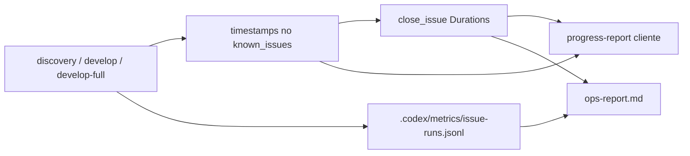
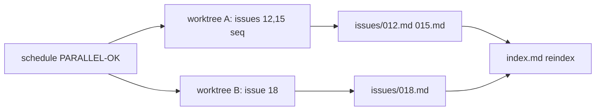
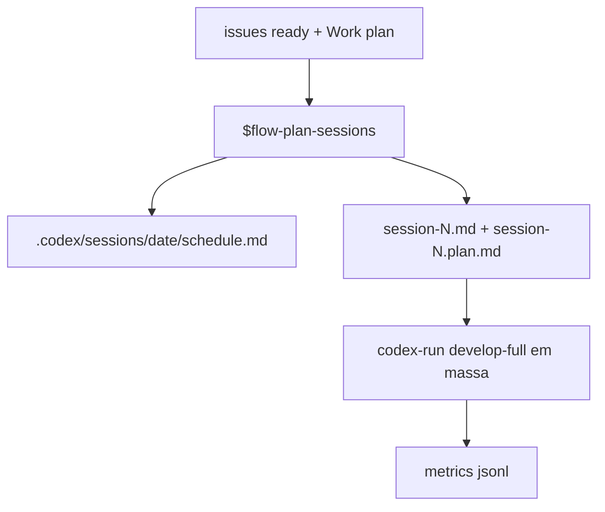

# Status

**APROVADO** em 2026-11-05. Documento canónico do ciclo 1.1.0 do Codex Flow.
Não executar automaticamente — implementação sob pedido explícito.

# Plano: fluxos enxutos + produto + skills comerciais + Adorable

## Princípio

1. **Mesma qualidade, menos LLM** quando script prova que o perfil não se aplica.
2. **Toda issue deixa rastros mensuráveis** (wall-clock por etapa + tokens quando disponíveis).
3. **Dois relatórios distintos:** cliente (avanço/valor) vs ops (custo/gargalos).
4. **Skills gerais + personalização no projeto** (brand/pricing/logo) — nunca embutir marca Codetomika no core do Flow.
5. **Artefatos de runtime gitignored**; **plano de trabalho na issue** + **criar sessão = já sair com plano e ordem do dia/semana** (um comando, massa inclusa).
6. **Tracker híbrido + paralelo de verdade:** um ficheiro por issue, worktrees por sessão, várias issues por sessão quando PARALLEL-OK; conflito residual no índice é barato e recuperável.



## O que já existe (não reinventar)

### Codex Flow — tempo de ciclo
- `promote.sh` / `transition.sh` / `create_issue.sh` / `close_issue.sh` já gravam `Opened`/`Ready`/`Started`/`In review`/…/`Resolved`.
- No archive: `- Durations: backlog=… dev=… review=… total=…` ([`close_issue.sh`](scripts/close_issue.sh), testes em [`test_timestamps.sh`](scripts/tests/test_timestamps.sh)).
- **Gap:** sem tokens; timestamps incompletos em muitas issues; sem rolling metrics enquanto abertas; sem join issue↔sessão Codex.

### Relatório de avanço (cliente) — Dia da Educação
- Projeto: [`~/dev/dia-da-educacao-2026`](file:///home/william_pereira/dev/dia-da-educacao-2026).
- Script local: `.codex/scripts/progress-report.sh` → `docs/progress/<date>-progress-report.{md,pdf,html}` + Gantt.
- Spec global: skill [`cf-progress-report`](skills/business-ops/progress-report/SKILL.md) (daily/retro), mas **o gerador não está no repo flow** — só no projeto.
- Usa status/horas da proposta; **não** lê `Durations:` nem custo LLM.
- App do Dia da Educação tem “Relatórios” admin (check-in/evento) — **outro domínio**, não confundir com Flow.

### Steward / history
- Steward ledger = correções de fluxo (não KPI de entrega).
- `flow-history` = sessões OpenCode exportadas, sem `issue_id`.

## Parte A — Discovery / develop / develop-full (custo ↓, qualidade =)

Igual à versão anterior do plano:

- **Discovery:** `discovery-route.sh` + `feat-lean` fail-closed; floors de `Tests:` no lint; sem orquestrador se `agents=[]`.
- **Delivery:** `delivery-route.sh` poda reviewers sem arquivos no domínio **sem** violar floor do loop / security; alinhar develop ao `test-runner` do full; teto 2 re-reviews.
- Detalhe completo mantido nas fases 1–2 abaixo.

## Parte B — Ledger de custo/tempo por issue (novo)

### Formato
Arquivo projeto: `.codex/metrics/issue-runs.jsonl` (gitignore se sensível; template em standards). Uma linha por etapa:

```json
{"issue":12,"flow":"develop-full","step":"senior-review","profile":"backend","started":"…","ended":"…","wall_ms":120000,"input_tokens":null,"output_tokens":null,"model":null,"agents":["cf_…"],"result":"ok"}
```

### Captura (fail soft)
1. Wrappers leves: início/fim em `discovery-route`, `delivery-route`, e nos skills parent após cada `Task` / script gate (`committer-check`, `test-runner`).
2. Tokens: preencher quando a ferramenta/CLI expuser uso (Codex session usage se disponível); senão `null` + `wall_ms` sempre — **nunca bloquear** o fluxo por falta de tokens.
3. No `close_issue.sh` (ou script auxiliar): agregar ledger → bloco opcional `- Cost: wall=… tokens_in=… tokens_out=…` no archive **ou** só deixar no JSONL + relatório ops (preferência: JSONL canônico + resumo no ops-report; campo markdown só se lint permitir).
4. Comando/skill: `$flow-issue-cost <id>` imprime resumo de uma issue.

## Parte C — Produto: relatórios organizados

Separar claramente:

| Relatório | Audiência | Fonte | Saída |
|-----------|-----------|-------|-------|
| **Progress (cliente)** | Cliente | issues + proposta/horas (+ opcional Durations) | `docs/progress/…` MD/PDF |
| **Ops (interno)** | Você / time | issues + Durations + `issue-runs.jsonl` + reviewers skipped | `.codex/reports/ops-<date>.md` (não cliente) |

### Ações
1. **Promover** o gerador do Dia da Educação para `~/.codex/flow/scripts/progress-report.sh` (parametrizado: proposal hours file / unmapped TSV paths no projeto). Projetos passam a chamar o script global; o de `dia-da-educacao-2026` vira thin wrapper ou some.
2. Estender o cliente report com seção opcional **ciclo de vida** (médias `Durations:` das resolvidas na janela) — sem expor tokens ao cliente.
3. Novo `scripts/ops-report.sh` + skill/`$flow-ops-report`:
   - issues abertas por status/idade (gargalo: tempo em `in-review` / `in-qa`);
   - custo estimado da janela (soma ledger);
   - top issues por `wall_ms` / tokens;
   - reviewers skipped vs run (eficiência do delivery-route);
   - steward classes recentes.
4. Comando catalog: `flow-progress-report` (já mapeável) + `flow-ops-report`.
5. Documentar em README § Product reporting: daily cliente vs ops interno; quando rodar cada um.

## Parte C1 — Tracker: um arquivo vs pasta (decisão)

**Recomendação: híbrido — pasta por issue + índice fino.** Não manter só o monolito `known_issues.md` a longo prazo, nem só N arquivos sem índice.

| Abordagem | Tokens (agente) | Massa / git | Scripts atuais | Visão de backlog |
|-----------|-----------------|-------------|----------------|------------------|
| Só `known_issues.md` | Carrega tudo | Conflito no mesmo arquivo em paralelo | Já funciona | Boa |
| Só `issues/*.md` | Carrega 1 issue | Paralelo seguro | Reescreve tudo | Ruim sem índice |
| **Híbrido** | Índice + 1 ficheiro | Paralelo por id | Adaptador + migração | Índice = backlog |

### Layout alvo
```text
.codex/
  issues/index.md          # tabela: id | title | status | type | severity | priority
  issues/012.md            # corpo canónico completo (Work plan, Tests, timestamps…)
  issues/resolved/012.md   # ao fechar (ou resolved/ espelhando archive)
  metrics/                 # gitignored
  sessions/                # gitignored
```

- **Índice** (`issues/index.md` ou `known_issues.md` reduzido a só a tabela): o que progress-report / session-plan / humanos leem para overview.
- **Corpo** (`.codex/issues/<id>.md`): o que developer/reviewer/`issue-lint` leem — um id por vez.
- **IDs:** `append-issue` aloca com flock no índice + cria o ficheiro; `transition`/`promote` editam só `issues/<id>.md` + uma linha do índice (conflitos raros).
- **Compat:** `scripts/issue-path.sh <id>` resolve ficheiro; wrappers temporários aceitam monolito antigo se `issues/` não existir (um ciclo de migração).
- **resolved:** mover ficheiro para `issues/resolved/` + linha no índice `resolved` ou `resolved_issues` index; Durations no corpo.

Por que agora: massa de sessões + Work plan + ledger pedem edições paralelas e menos tokens — o monolito (~200–400+ linhas já no Dia da Educação / flow) escala mal.

### Paralelo: o que destravar (além do híbrido)

Hoje o gargalo não é só o markdown: (1) monolito `known_issues`/`resolved` em toda transição; (2) planner prefere 1 issue/sessão; (3) código no mesmo worktree. Aceitar conflito no tracker **compensa** se o conflito for **pequeno** (só índice) e o código for isolado.

| Camada | Melhoria | Efeito |
|--------|----------|--------|
| Tracker | Editar só `issues/<id>.md` + 1 linha no índice; `flock` por id | Quase sem conflito entre issues diferentes |
| Índice | `scripts/issues-reindex.sh` regenera `index.md` a partir dos ficheiros | Conflito no índice → reindex, não merge manual longo |
| Resolved | `issues/resolved/<id>.md` (move atómico) em vez de append num monolito | Fecha em paralelo sem brigar no `resolved_issues.md` |
| Código | `session-plan --worktree`: um git worktree por sessão PARALLEL | Branches/PRs sem misturar working tree |
| Sessão | Permitir **N issues PARALLEL-OK na mesma sessão em sequência** (já no planner) **e** N sessões/worktrees em paralelo de verdade | Uma sessão “cheia” + várias ao mesmo tempo |
| Launch | `session-plan --launch --parallel N` sobe até N `codex-run` (ou Cursor agents) com lock de worktree | Massa sem pedir uma a uma |
| Merge | Após MRs: `git worktree remove`; reindex; opcional `merge-index` no post-merge | Limpeza |

**Política explícita:** conflito em `issues/012.md` entre duas sessões na **mesma** issue = bug de schedule (não deveria); conflito só em `index.md` = esperado sob paralelismo alto → `issues-reindex.sh` e segue. Não voltar ao monolito “porque conflita um pouco”.



## Parte C2 — Sessões, planos e gitignore (massa)

### Problema hoje
- `preflight/`, `reviews/`, `design-outputs/` já entram no `.codex/.gitignore` via [`flowctl.py` init](scripts/flowctl.py) — mas **sessões / delivery-prompts / planos de sessão** ainda podem ir para git (`docs/delivery-prompts/` no skill atual).
- [`cf-delivery-session-planner`](skills/development/delivery-session-planner/SKILL.md) existe, porém é um passo **separado**: criar sessão ≠ gerar plano; o usuário pede duas vezes.
- Issues têm `Suggested fix:` mas **não** um `- Work plan:` estruturado (passos verificáveis).
- Não há artefato único “próximo dia/semana” que orquestre `$develop-full` em massa.
- Monolito `known_issues.md` amplifica conflito git e custo de contexto na massa.

### Gitignore (sempre)
Expandir o bloco managed em init + template global:

```text
preflight/
reviews/
design-outputs/
sessions/
metrics/
```

- Sessões e planos gerados: **somente** `.codex/sessions/<date>/` (prompts + `schedule.md` + `session-*.plan.md`).
- Remover/desencorajar `docs/delivery-prompts/` versionado; se existir legado, documentar migração → `.codex/sessions/` (gitignored).
- `metrics/issue-runs.jsonl` também ignorado (Parte B).
- Teste: `test_init` / `test_flowctl` asserta essas entradas.

### Plano na issue (versionado, curto)
No padrão de issues (`standards/issues.md` + lint):

- Campo opcional-recomendado: `- Work plan:` lista de 3–8 passos (`→` outcomes), gerado no **discovery** (feat-lean/full) a partir de regras + Tests + Suggested fix.
- `issue-lint`: warn se `feat`/`bug` ready sem Work plan; strict opcional depois.
- Isso fica no `known_issues.md` (rastreável); **não** substitui o plano detalhado da sessão.

### Um comando: sessão já nasce com plano
Unificar planner + schedule em `$flow-plan-sessions` (script + skill):

```bash
scripts/session-plan.sh [--horizon day|week] [--ids 12,13] [--launch]
```

Saída em `.codex/sessions/<YYYY-MM-DD>/`:

| Arquivo | Conteúdo |
|---------|----------|
| `schedule.md` | Ordem do horizonte (dia/semana): fases, PARALLEL-OK vs CONFLICT, IDs |
| `session-N.md` | Prompt auto-contido (issue embutida + Work plan + comando `$develop` / `$develop-full`) |
| `session-N.plan.md` | Plano de execução da sessão (passos, arquivos, reviewers, gates) — **sempre** gerado junto |

Comportamento:
1. Coletar `ready` (ou `--ids`); exigir Work plan ou gerar rascunho a partir do issue (script/LLM mínimo).
2. Reusar regras de conflito/esforço do delivery-session-planner.
3. **Não** pedir segundo passo “agora cria o plano”.
4. `--launch [--parallel N]`: sobe sessões conforme schedule; com `--worktree` cria `../.flow-worktrees/<session>/` (ou path configurável) a partir da base branch.
5. Sessão pode listar **vários ids** se PARALLEL-OK e esforço cabe no limite; prompt embute Work plans de todos.
6. Atualizar skill `cf-delivery-session-planner` para delegar ao script; paths gitignored; documentar “conflito de índice → reindex”.

### Massa + produto
- Ops-report lista sessões do horizonte e issues sem Work plan (gargalo de planning).
- Ledger (Parte B) marca `session_id` / path sob `.codex/sessions/`.
- Telegram/OpenWA: um aviso ao gerar o schedule (“N sessões, ordem …”); outro ao terminar batch se `--launch`.



## Parte C3 — Problemas de 1ª instalação (máquina limpa)

Auditoria [Audit first-time install pitfalls](ff723585-dc92-4ade-8144-3fdd6e24b8a0). Se alguém clona o repo hoje e só roda `bash install.sh`:

### Install global (silencioso ou quebrado depois)
1. **`skills_dir` default = `~/.agents/skills`** — Cursor nesta máquina lê `~/.codex/skills`; install “ok” mas Cursor não vê skills.
2. **`vendor/` vazio** (gitignored) → `vendor_skills: 0` sem aviso; falta `restore-vendors.py` obrigatório no README/install.
3. **Symlinks absolutos** para o checkout — mover a pasta quebra tudo até re-install.
4. **Sem preflight** de Python 3.11+, git, Codex CLI, gh/glab, jq.
5. **Sem `telegram.env`** — `flow-notify.sh` engole falha (exit 0); develop não STOP como o skill promete.
6. **Não valida** (`validate.py` / testes) no fim do install.
7. Docs/scripts ainda citam `opencode.json` em pontos (skill-vendor, aibot-watcher).

### Agents
1. Globais: 116 `.toml` linkados em `~/.codex/agents/` — OK se o checkout está estável.
2. **Projeto:** init cria `.codex/agents/*.toml` e **não** espelha em `~/.codex/agents/`; se o runtime só escanear home, roles locais ficam invisíveis.
3. Greenfield sem skills locais → **não** cria `.agents/skills/` (surpresa vs runtime.md).

### Init de projeto
1. Locale default **`pt`** mesmo em repo EN.
2. Stub `known_issues.md` de 2 linhas — **não passa** `issue-lint` / discovery real até o primeiro ciclo bem-sucedido.
3. Sem `resolved_issues.md` até o primeiro close.
4. Migração: conflitos preservados sem merge; `opencode.json` legado **fica** no disco ao lado do `.codex/`.
5. `config.sh`: fora de git → scripts podem escrever no tracker **global** do flow (footgun).
6. Gitignore de init ainda sem `sessions/` / `metrics/` (Parte C2).

### Sequência segura (a endurecer no install)
```bash
git clone … && cd codex-flow
bash install.sh --skills-dir ~/.codex/skills   # virar default
python3 scripts/restore-vendors.py
cp .codex/telegram.env.example .codex/telegram.env  # preencher
python3 scripts/validate.py && python3 scripts/tests/test_flowctl.py
bash scripts/init.sh /path/to/project <locale>
```

### Correções no plano (Fase install)
- Default `skills_dir` → `~/.codex/skills` + espelho `~/.cursor/skills` + rule.
- `install --check`: deps, vendors>0 ou WARN, telegram example missing WARN, symlink target exists.
- `flow-notify`: exit ≠ 0 se ambos canais falharem **ou** alinhar develop SKILL (“notify best-effort”).
- Init: template `known_issues` mínimo lintável (ou `issues/index` + README); locale explícito obrigatório se não detectável; criar `resolved_issues.md` vazio; gitignore sessions/metrics; warn se cwd sem git ao usar scripts de issue.
- Documentar re-install após mover checkout; preferir relative symlinks onde possível.

## Parte D — Skills comerciais do landing (generalizar sem marca)

Fonte: [`~/dev/codetomika-landing-page`](file:///home/william_pereira/dev/codetomika-landing-page) hub `company/admin/` ([Map codetomika landing skills](5101b0ee-13e1-4753-ad32-6835da2fb45b)).

Hoje o Flow tem `cf-proposal-writer` / `cf-tech-spec` / `cf-progress-report` / `cf-strategic-brief` **como texto**, mas o toolchain rico (`proposal.py`, `render_docx.py`, `novo-cliente.sh`, `spec-init.sh`, `consulta-cnpj.sh`, templates A/B/C) está **só no landing**, com overrides locais e R$ 180/h / logos hardcoded.

### Trazer para `~/.codex/flow` (neutro)
- Scripts: proposal render trio + `novo-cliente.sh` + `spec-init.sh` + `consulta-cnpj.sh` + `shared/convert-*` (se ainda não unificados).
- Templates/standards: discovery, tech-spec (12 dimensões), proposta A/B/C, acompanhamento — placeholders `{{company}}`, `{{logo_path}}`, `{{hourly_rate}}`.
- Skills/comandos: endurecer `cf-proposal-writer`, `cf-tech-spec`, discovery comercial, `cf-consulta-cnpj` (novo se faltar), `flow-proposal` / `flow-tech-spec` apontando aos scripts globais.

### Ficar no projeto (personalização)
Contrato local sob `.codex/brand/` ou `company/admin/docs/empresa/`:

```text
brand.profile.json   # razão social, issuer, locale
brand.tokens.md      # cor, tipografia
brand/logo.*         # paths PDF vs site
pricing.md           # taxa, repasse, mínimo
positioning.md       # guardrails editoriais
contract.masters/    # se houver
```

Precedência: skill/projeto local **vence** o `cf-*` (já documentado no landing) — o install/global não remove esse hook.

### Não trazer como “global genérico”
- `codetomika-vagas`, emails/HTML com marca, `docs/DESIGN.md` do site (#BBCE00), contratos nominais, artefatos de clientes (`company/projects/*`).
- Blog/social image pipeline: opcionalmente depois, com logo via brand profile — **fora do núcleo deste ciclo** salvo thin adapter.

## Parte E — Adorable flow (revisão)

Hoje ([Review Adorable and sector skills](cb5af1b1-3039-45b8-9088-b44eb87a8a70)): `$flow-build-ui` = art-director → ui-architect → ui-implementer → ui-critic (≤3 loops); `$flow-audit-ui` = auditor → refactor-planner → opcional build. Agentes ~3.6k linhas e re-embedem as 4 skills de design.

### Revisões (qualidade =, tokens ↓)
1. Agentes só com papel + schema JSON + “ler skill X seção Y”; conteúdo canônico nas skills `design-tokens` / `reference-library` / `component-patterns` / `visual-hierarchy`.
2. Handoffs só por path em `.codex/design-outputs/<session>/` (já no standard); loops critic↔implementer passam checklist IDs + diff, não re-ler árvore inteira.
3. Routing documentado: exploração rápida → `agents/designer.md` + taste vendor; produção/gate → `$flow-build-ui` / `$flow-audit-ui`.
4. Preferência de capacidade só em texto (sem `model:`); implementer herda sessão.
5. Arquivar `.codex/adorable-proposal/*` (ainda com `model:` legado) após extrair o que faltar para `standards/design-pipeline.md`.
6. (Opcional neste ciclo) um checklist visual mínimo no critic — sem novo serviço obrigatório.

## Parte F — Hubs marketing / financeiro / design

| Pack | Situação | Ação |
|------|----------|------|
| Marketing (26) | 6 stubs ~39L; `seo-optimizer` 747L monólito | Hub `marketing-router` (quando usar qual); stubs pointer-only; TOC/split lazy do SEO; `frontend-design` aponta Adorable/`design-tokens` |
| Finance (6) | Checklists uniformes; overlap commercial/BI | Hub finance com outputs (modelo, board, variance); clarificar vs `skills/bi` e `commercial/*` no catalog |
| Design | 4 skills nativas fortes; duplicadas nos agentes | README routing Adorable vs taste vs audit; dedupe via Parte E |

Fatorar o “Codex runtime contract” repetido (~28 linhas × N skills) para um include curto referenciado — reduz tokens de descoberta sem mudar comportamento.

## Fases de execução

### Fase 1 — Discovery enxuto
### Fase 2 — Develop / develop-full enxutos
### Fase 3 — Ledger + hooks
### Fase 4 — Relatórios produto (cliente + ops)
### Fase 5 — Tracker híbrido + reindex + locks por id (base do paralelo)
### Fase 6 — session-plan + worktrees + --launch --parallel (massa)
### Fase 7 — Comercial generalizado (landing → flow + brand profile)
### Fase 8 — Adorable enxuto + hubs marketing/finance/design
### Fase 9 — Resolve/steward/modelos/install Cursor
### Fase 10 — VERSION 1.1.0 + README/CHANGELOG

## Fora de escopo
- Dashboard web in-app do Dia da Educação (check-in).
- Publicar `company/` do landing no site.
- Reescrever as 26 skills de marketing do zero.
- Preço $/token de API (só wall + tokens brutos; $/1k opcional depois).
- Afrouxar floors de tests/review/committer.
- Commit/push sem pedido.
- Orquestrador cloud multi-máquina (só `codex-run` local + schedule).
