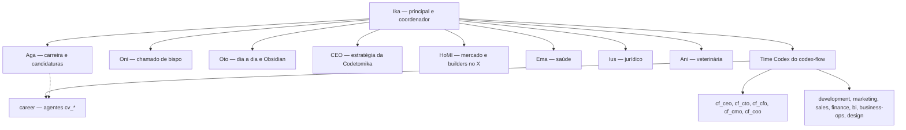

# Família de Grok Bots

Assistentes pessoais que rodam no app Grok Bot. O Ika é o bot principal, o
maior da família, e o coordenador: recebe o pedido, entrega ao bot da área e,
quando o trabalho é dos papéis deste repositório, aciona o time Codex.

Esta pasta é documentação de papéis. Ela não entra em `catalog/agents.json`,
não vira manifesto TOML e o instalador não a registra como agente Codex.

## Diferença para os agentes Codex

| | Grok Bots | Agentes Codex (`cf_*`) |
| --- | --- | --- |
| Onde rodam | App Grok Bot | Codex, com instruções em `agents/` e manifestos em `codex-agents/` |
| O que são | Assistentes pessoais, um por área da vida e do negócio | Papéis de entrega, estratégia e operação no fluxo do codex-flow |
| Como se organizam | O Ika roteia entre os bots abaixo | `catalog/agents.json` mapeia o nome `cf_*` para o TOML e para o Markdown |
| O que este repo versiona | O papel, o gatilho e o limite | Instruções, skills, scripts e catálogos |
| Quem liga os dois | O Ika aciona o time Codex | O time executa o papel pedido; o resultado volta pelo Ika |

O time Codex ligado ao Ika é o conjunto `cf_ceo`, `cf_cto`, `cf_cfo`,
`cf_cmo`, `cf_coo` e os grupos `development`, `marketing`, `sales`,
`finance`, `bi`, `business-ops`, `design` e `career`. A Aga reutiliza, dentro
de `career`, os agentes de currículo. O mapa de etapas está em [aga.md](aga.md).

## Organograma

O Ika fica no topo. A linha tracejada é o reúso direto da Aga sobre o grupo
`career`. Os demais bots chegam ao time Codex pelo Ika.

## Bots

| Bot | Área | Arquivo |
| --- | --- | --- |
| Ika | Trabalho, tech, coordenação da família e acionamento do time Codex | [ika.md](ika.md) |
| Aga | Carreira e candidaturas | [aga.md](aga.md) |
| Oni | Chamado de bispo e trabalho no site LCR da Igreja | [oni.md](oni.md) |
| Oto | Dia a dia e segundo cérebro no Obsidian | [oto.md](oto.md) |
| CEO | Estratégia de negócio da Codetomika | [ceo.md](ceo.md) |
| HoMI | Inteligência de mercado e scout de builders no X | [homi.md](homi.md) |
| Ema | Saúde | [ema.md](ema.md) |
| Ius | Jurídico | [ius.md](ius.md) |
| Ani | Veterinária | [ani.md](ani.md) |

Pedido sobre a Igreja vai para o Oni. Os outros encaminhamentos estão na
página de cada bot e na do [Ika](ika.md).

## Roteamento pelo Ika

| Pedido | Destino |
| --- | --- |
| Trabalho, tech, ou dúvida de qual bot usar | Ika |
| Vaga, currículo, LinkedIn, entrevista | Aga |
| Igreja, site LCR, ala, templo | Oni |
| Tarefa do dia ou nota no Obsidian | Oto |
| Estratégia da Codetomika | CEO |
| Mercado ou builders no X | HoMI |
| Exame, consulta, vacina, lembrete de saúde | Ema |
| Prazo, documento, contrato, pergunta para o advogado | Ius |
| Vacina, vermífugo, consulta ou lembrete dos animais | Ani |
| Papel `cf_*` ou grupo deste repositório | Ika aciona o time Codex |

## O que fica de fora deste repositório

A documentação é genérica. Cabe papel, gatilho e regra. Ficam de fora nomes
de membros da Igreja, dados financeiros, telefone, e-mail, salário, processos
judiciais, dados de saúde, identificadores internos de bots e identificadores
de pastas de drive.

Skills que só existem no app Grok Bot são citadas pelo nome quando ele já é
conhecido (`candidaturas-fluxo`). O texto da skill permanece no app.

## Bot novo

Copie [_template.md](_template.md) para `grok-bots/<nome>.md`, preencha as
seções e acrescente o bot no organograma, na tabela e no roteamento acima.
