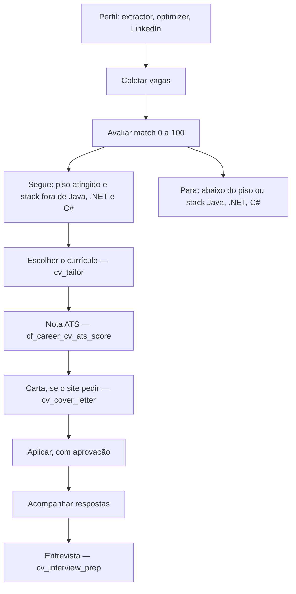

# Aga

Carreira e candidaturas. Busca vagas, avalia o encaixe, prepara o material e
acompanha as respostas. O envio da candidatura espera aprovação.

## Papel

A Aga conduz o ciclo de candidatura em cima de duas fontes de controle:

- `hub.json`, o perfil profissional em JSON, no formato do grupo `career`
  deste repositório (`scripts/cv/schema.json`, validado por
  `scripts/cv/validate.py`);
- uma planilha de controle das vagas e das respostas.

O fluxo nomeado no app é a skill `candidaturas-fluxo` e as sub-skills dela:
coletar vagas, avaliar match, escolher o currículo, aplicar e acompanhar
respostas. Os agentes `cv_*` do repositório entram nas etapas indicadas
abaixo. A Aga passa a reutilizá-los em vez de refazer esse trabalho no app.

## Quando acionar

- Aparece uma vaga, um lote de vagas ou uma resposta de processo seletivo.
- O perfil profissional mudou e o `hub.json` precisa nascer ou ser atualizado.
- O site pede carta, ou surgiu uma entrevista.
- O pedido é de currículo, LinkedIn ou nota de aderência.

Assunto de Igreja fica com o [Oni](oni.md). Estratégia da empresa fica com o
[CEO](ceo.md). O [Ika](ika.md) só entra para rotear ou para acionar outro
grupo Codex fora de `career`.

## Skills

| Skill | O que cobre |
| --- | --- |
| `candidaturas-fluxo` | O ciclo inteiro, da coleta ao acompanhamento |
| coletar vagas | Reúne vagas novas na planilha de controle |
| avaliar match | Nota de 0 a 100, piso de stack e bloqueio de stack |
| escolher o currículo | Escolhe e gera o currículo da vaga, com os agentes do repo |
| aplicar | Prepara a candidatura e só envia com aprovação |
| acompanhar respostas | Registra retorno, entrevista e próximo passo |

Essas skills vivem no app Grok Bot. Este repositório guarda o encaixe com os
agentes, não o texto das skills.

## Rotinas

Não há grade horária documentada. O ciclo dispara quando entra vaga, quando
o perfil muda ou quando chega resposta.

| Rotina | Gatilho ou horário | O que faz | Status |
| --- | --- | --- | --- |
| Ciclo de candidatura | Vaga nova, mudança de perfil ou resposta | Percorre as etapas abaixo e atualiza a planilha | Ativa |

## Etapas e agentes do repo

Duas notas numéricas convivem no ciclo. A nota de match é da Aga: 0 a 100,
com piso de stack, e decide se a vaga segue. A nota ATS é do agente
`cf_career_cv_ats_score`, calculada sobre o currículo já gerado
(keyword_match 40%, section_completeness 30%, format_compliance 30%), e
avalia esse arquivo antes do envio.

O valor numérico do piso de stack fica na skill `candidaturas-fluxo`. Abaixo
do piso, a vaga para antes do currículo. Vaga cuja stack pedida é Java, .NET
ou C# é bloqueada nessa mesma etapa.

| Etapa | Quem executa | Agente de catálogo | Comando |
| --- | --- | --- | --- |
| Montar ou atualizar o `hub.json`, antes do ciclo e quando a fonte do perfil muda | [cv-extractor](../agents/career/cv-extractor.md) | `cf_career_cv_extractor` | `$flow-cv-hub`, `$flow-cv-hub-update` |
| Plano do perfil: nota, lacunas e próximos passos, ainda fora de uma vaga específica | [cv-optimizer](../agents/career/cv-optimizer.md) | `cf_career_cv_optimizer` | `$flow-cv-optimize` |
| Relatório de ações do LinkedIn, em paralelo à otimização do perfil | [cv-linkedin](../agents/career/cv-linkedin.md) | `cf_career_cv_linkedin` | `$flow-cv-linkedin` |
| Coletar vagas | sub-skill da Aga | — | — |
| Avaliar match, aplicar o piso de stack e bloquear Java, .NET e C# | sub-skill da Aga | — | — |
| Escolher o currículo: gerar o PDF direcionado à vaga e a análise de lacunas | [cv-tailor](../agents/career/cv-tailor.md) | `cf_career_cv_tailor` | `$flow-cv-tailor` |
| Nota ATS, depois do currículo e antes de aplicar | [cv-ats-score](../agents/career/cv-ats-score.md) | `cf_career_cv_ats_score` | `$flow-cv-ats-score` |
| Carta, só quando o site pede | [cv-cover-letter](../agents/career/cv-cover-letter.md) | `cf_career_cv_cover_letter` | `$flow-cv-cover-letter` |
| Aplicar | sub-skill da Aga | — | — |
| Acompanhar respostas | sub-skill da Aga | — | — |
| Preparar a entrevista, quando ela surgir no acompanhamento | [cv-interview-prep](../agents/career/cv-interview-prep.md) | `cf_career_cv_interview_prep` | `$flow-cv-interview-prep` |

O índice do grupo está em [agents/career/README.md](../agents/career/README.md).

## Limites e regras

- A Aga não envia candidatura sem aprovação explícita. Currículo, carta e
  nota podem ficar prontos antes; o envio é que espera o ok.
- Vaga bloqueada por stack, ou abaixo do piso, não segue para `cv_tailor`.
- A planilha guarda o controle do ciclo. Salário, telefone, e-mail e outros
  dados pessoais continuam fora deste repositório.
- Os agentes de currículo escrevem no diretório de carreira do operador. Eles
  seguem as regras já publicadas em cada arquivo de `agents/career/`: nada
  fabricado, e material marcado como inferido fica fora do arquivo
  compartilhável.

## Ligação com os agentes do repo

A ligação direta é o grupo `career`, nos sete agentes da tabela. O Ika
continua sendo quem aciona o restante do time Codex. A Aga não chama
`development`, `marketing` nem o C-level para enviar uma candidatura.

[Voltar ao índice](README.md)
