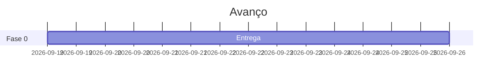

# Relatório de Avanço — [PROJETO]

> Data: **[DATA]** · Emissor: {{issuer}}


## 1. Resumo executivo
## 2. Distribuição por status / tipo / severidade
## 3. Issues por fase



## 4. Pendências operacionais

Generate full reports with:

```bash
bash ~/.codex/flow/scripts/progress-report.sh
```
