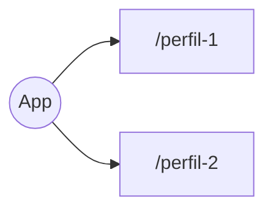

<!--
Template: Padrão A — Software sob medida (standards/commercial/proposta.md).
Padrão C: proposta-diagnostico.md · Padrão B: proposta-cto-externo.md
-->

# Proposta Comercial
## [PROJETO]

**Para:** [CLIENTE] · **De:** {{issuer}} · **Data:** [DATA] · **Validade:** 15 dias

## 1. O que estamos construindo

## 2. Problema que resolve

| Hoje | Com a plataforma |
|---|---|
| | |

## 3. Escopo por fase
## 4. Modelo de atuação equipe e responsabilidades

Como as entregas serão acompanhadas, papéis e ponto focal. Mobilização e continuidade: condições confirmadas ou a definir no contrato; não presumir SLA ou reposição gratuita.

## 5. Diferenciais e resultados esperados

Relacionar cada diferencial da emissora a uma entrega verificável. Informar como acompanhar os resultados, sem percentuais ou ROI sem evidência.

## 6. Cronograma e marcos

## 7. Investimento do projeto

**Investimento total:** [VALOR] · **Modelo:** [estimativa ou preço fechado ou horas].

Taxa de referência: {{hourly_rate_formatted}}/h (`.codex/brand/pricing.md`).

O valor inclui [ENTREGAS]. Fora do valor: [ITENS E RESPONSÁVEL PELO CUSTO]. Rateio, se aplicável: [CONDIÇÃO A APROVAR].

| Entrega incluída | Valor |
|---|---:|
| [ENTREGA] | [VALOR] |
| Total | [TOTAL] |

## 7.1 Como e quando pagar

| Parcela | Evento ou vencimento | Valor |
|---|---|---:|
| [NÚMERO] | [MARCO E CONTAGEM DO PRAZO] | [VALOR] |
| Final | [CONDIÇÃO DE ACEITE E RETENÇÃO] | [VALOR] |
| Total | | [TOTAL] |

## 7.2 Memória de cálculo

Horas por frente e bloco, total × {{hourly_rate_formatted}}/h, descontos e valor final.

## 8. Condições comerciais
## 9. Próximos passos e aceite
